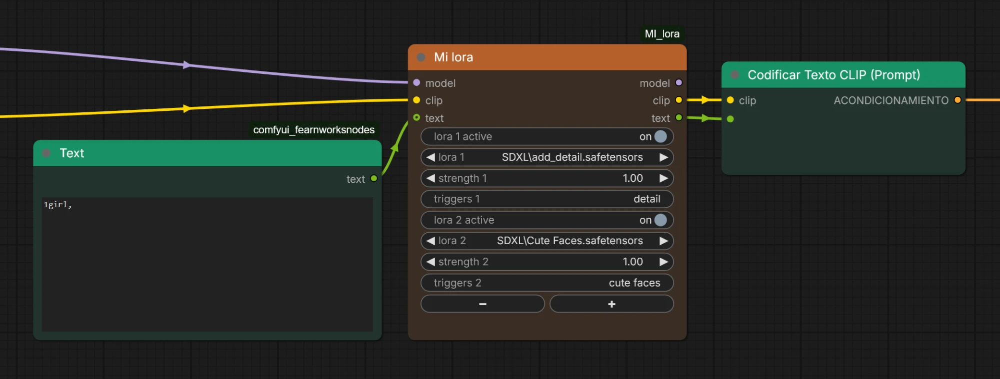

# MI_lora

A ComfyUI custom node (shown as **MI Lora**) that loads several LoRAs from a single node and **remembers the trigger words of each one**. Write the trigger words once; they are saved per LoRA, filled in automatically the next time you pick it, and sent as text to your prompt.



## Why

Stacking LoRAs usually means a chain of loader nodes plus a notes file to remember which words activate each one. MI Lora puts everything in one compact node: the LoRAs, their strengths, their trigger words and a switch to turn each one on or off without rewiring.

## Features

- **Several LoRAs in one node**: use the `+` and `-` buttons to add or remove rows (up to 8).
- **On / off per LoRA**: every row has its own switch. A row that is off is skipped: the LoRA is not applied and its trigger words are not sent. The fields of that row are greyed out, and the saved trigger words are kept.
- **One strength per LoRA**: from -10 to 10, applied to both model and clip.
- **Trigger words per LoRA**: type them in the `triggers` field of each row. They are saved for that LoRA and filled in automatically whenever you pick it again, in any node or workflow.
- **Sent as text**: the `text` output is your incoming prompt followed by the trigger words of every active LoRA, ready for a standard `CLIPTextEncode`.
- **Subgraph friendly**: every row uses standard widgets, so they can be promoted to a subgraph.

## Installation

Clone this repository into your ComfyUI `custom_nodes` folder and restart ComfyUI:

```bash
cd ComfyUI/custom_nodes
git clone https://github.com/ThinkingBells/MI_lora.git
```

Then reload the browser tab (Ctrl+F5) so the new interface code is loaded. No extra dependencies are needed.

## Usage

1. Add the node: double-click the canvas and search for **MI Lora** (category `MI nodes`).
2. Connect `model` and `clip`, and optionally a `STRING` prompt to `text`.
3. Pick a LoRA, set its strength and write its trigger words (comma separated). Use `+` / `-` to add or remove rows.
4. Connect `model` and `clip` to your sampler and text encoder, and `text` to the text input of a `CLIPTextEncode` node (convert the widget to an input first).

### Output example

With two LoRAs whose trigger words are `detail` (`add_detail`) and `cute faces` (`Cute Faces`):

| Text in | LoRA rows | `text` output |
|---------|-----------|---------------|
| `1girl,` | `add_detail` (on), `Cute Faces` (on) | `1girl, detail, cute faces` |
| `1girl,` | `add_detail` (on), `Cute Faces` (off) | `1girl, detail` |
| nothing connected | `add_detail` (on) | `detail` |

Rows set to `(none)` are ignored.

## Where the data is stored

`triggers.json` in the node folder (LoRA name -> trigger words). It is created the first time you save trigger words and is ignored by git, so your personal notes are never committed. Back it up if you want to keep it. Nothing is sent anywhere.

## Good to know

- Trigger words are tied to the LoRA **path and file name** inside the `loras` folder. If you rename or move a LoRA file, it is treated as a new one; edit the key in `triggers.json` to carry the data over.
- The LoRA list is read when ComfyUI starts. Restart ComfyUI after adding new LoRA files.
- A standard `CLIPTextEncode` has no syntax for LoRAs (unlike embeddings), so the LoRAs are applied to the `model` and `clip` outputs, not through the text.

## Files

- `__init__.py`: node, LoRA loading, trigger storage and API routes.
- `js/mi_lora.js`: frontend extension (row show/hide, `+` / `-` buttons, greyed rows, loading and saving of trigger words).

## License

[MIT](LICENSE) © 2026 Thinkingbells
