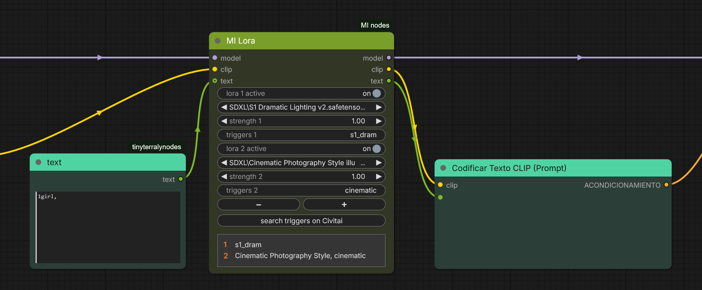

# MI_lora

[](LICENSE)

A ComfyUI custom node (shown as **MI Lora**) that loads several LoRAs from a single node and **remembers the trigger words of each one**. Write the trigger words once; they are saved per LoRA, filled in automatically the next time you pick it, and sent as text to your prompt. Not sure what a LoRA's trigger words are? **Look them up on Civitai** from the node.



> **MI Lora is also part of the [MI nodes](https://github.com/ThinkingBells/MI_nodes) pack**, together with MI Unet Rate, MI Embedding, MI Compare 3 Images, MI Save Image and MI Reroute Sound. Install either this repository or the pack, not both: the node would appear twice.

## Why

Stacking LoRAs usually means a chain of loader nodes plus a notes file to remember which words activate each one. MI Lora puts everything in one compact node: the LoRAs, their strengths, their trigger words and a switch to turn each one on or off without rewiring.

## Features

- **Several LoRAs in one node**: use the `+` and `-` buttons to add or remove rows (up to 8).
- **On / off per LoRA**: every row has its own switch. A row that is off is skipped: the LoRA is not applied and its trigger words are not sent. The fields of that row are greyed out, and the saved trigger words are kept.
- **One strength per LoRA**: from -10 to 10, applied to both model and clip.
- **Trigger words per LoRA**: type them in the `triggers` field of each row. They are saved for that LoRA and filled in automatically whenever you pick it again, in any node or workflow.
- **Civitai lookup**: press **search triggers on Civitai** at the bottom of the node. Every active LoRA is looked up by its file hash and a framed box lists the trigger words found, one numbered result per row. Click a result to put its words in that row's `triggers` field. Long lists wrap onto several lines. Results without trigger words (or not found) are shown in italics and are not clickable.
- **Sent as text**: the `text` output is your incoming prompt followed by the trigger words of every active LoRA, ready for a standard `CLIPTextEncode`.
- **Subgraph friendly**: every row uses standard widgets, so they can be promoted to a subgraph.

## Installation

Clone this repository into your ComfyUI `custom_nodes` folder and restart ComfyUI:

```bash
cd ComfyUI/custom_nodes
git clone https://github.com/ThinkingBells/MI_lora.git
```

Then reload the browser tab (Ctrl+F5) so the new interface code is loaded. No extra dependencies are needed. To update, run `git pull` inside the folder and restart.

## Usage

1. Add the node: double-click the canvas and search for **MI Lora** (category `MI nodes`).
2. Connect `model` and `clip`, and optionally a `STRING` prompt to `text`.
3. Pick a LoRA, set its strength and write its trigger words (comma separated), or fetch them from Civitai. Use `+` / `-` to add or remove rows.
4. Connect `model` and `clip` to your sampler and text encoder, and `text` to the text input of a `CLIPTextEncode` node (convert the widget to an input first).

### Output example

With two LoRAs whose trigger words are `detail` (`add_detail`) and `cute faces` (`Cute Faces`):

| Text in | LoRA rows | `text` output |
|---------|-----------|---------------|
| `1girl,` | `add_detail` (on), `Cute Faces` (on) | `1girl, detail, cute faces` |
| `1girl,` | `add_detail` (on), `Cute Faces` (off) | `1girl, detail` |
| nothing connected | `add_detail` (on) | `detail` |

Rows set to `(none)` are ignored.

## Civitai lookup and privacy

Nothing is sent until you press the search line. Then only the SHA256 hash of each active LoRA file is sent to `civitai.com`, never the file itself. Hashes are cached in `hashes.json`, so each file is hashed only once (the first search on a large LoRA can take a few seconds). A LoRA that is not on Civitai, or that lists no trigger words, is reported as such.

## Where the data is stored

Two files in the node folder, both ignored by git so your personal data is never committed:

| File | Content |
|------|---------|
| `triggers.json` | LoRA name to trigger words |
| `hashes.json` | Cached SHA256 of your LoRA files, for the Civitai lookup |

Back up `triggers.json` if you want to keep your notes. Nothing leaves your computer except the LoRA hash you send to Civitai when you press the search line.

## Good to know

- Trigger words are tied to the LoRA **path and file name** inside the `loras` folder. If you rename or move a LoRA file, it is treated as a new one; edit the key in `triggers.json` to carry the data over.
- The LoRA list is read when ComfyUI starts. Restart ComfyUI after adding new LoRA files.
- A standard `CLIPTextEncode` has no syntax for LoRAs (unlike embeddings), so the LoRAs are applied to the `model` and `clip` outputs, not through the text.

## Files

- `__init__.py`: node, LoRA loading, trigger storage, Civitai lookup and API routes.
- `js/mi_lora.js`: frontend extension (row show/hide, `+` / `-` buttons, greyed rows, trigger words, Civitai results box).

## License

[MIT](LICENSE) © 2026 Thinkingbells
